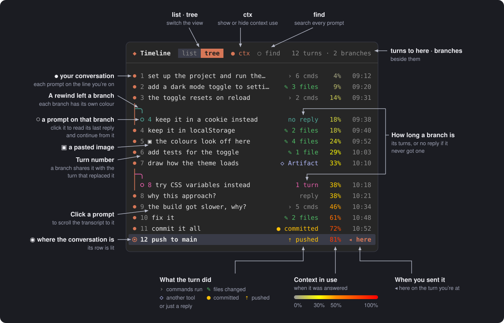
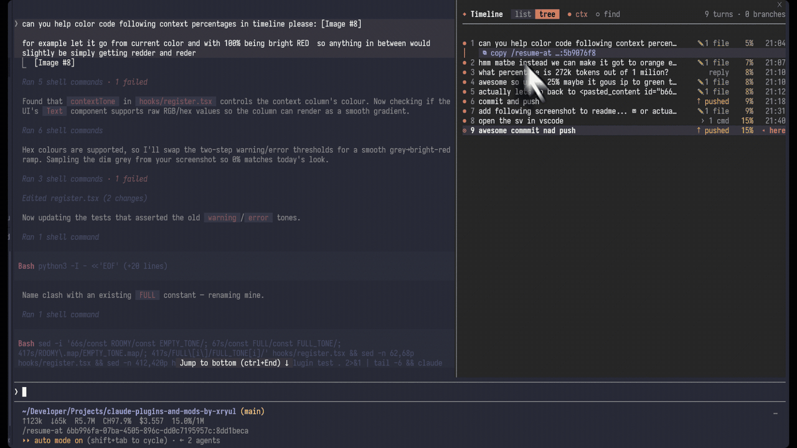
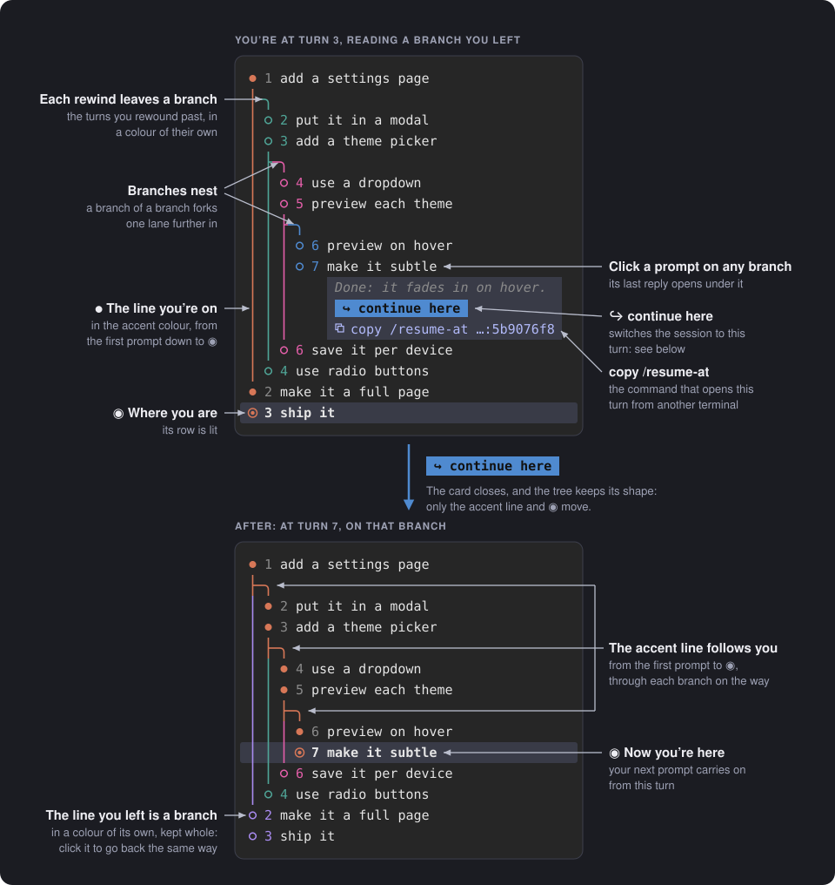

# prompt-timeline

A pane beside the chat that shows every prompt in the current session, as a tree of every branch a rewind left behind or as a list, with how much of the context window was in use and when you sent it.



- Click a prompt to scroll the transcript to it.
  
- Use list to see the prompts in the order you sent them, with how long ago, and ctx to show or hide the context column in both views.
- The context column is grey while the window has room and turns yellow by 30%, orange by 50% and bright red at 100%, shading smoothly between them.
- Use find to search the full text of every prompt, in either view: the tree lights each match where it sits and dims the rest, and the list shows only the matches, newest first.
- The pane opens on the tree: every branch a rewind left behind, to continue from one. A rewind to the very first prompt is a branch too, forking off above it. Each prompt is a numbered dot on its branch's line, followed by what its turn did (files changed, commands run, a commit or a push), how much of the context window was in use, and when you sent it. Your own line is in the accent colour, and every other branch has a colour of its own. Click a prompt on another branch to read its last reply and continue from it. Each card copies a `/resume-at` command.
  
- A fork is a branch too. The desktop app's Fork makes a new chat, and so does `/resume-at` when it copies a session. The tree finds every chat in the project that starts with this one's first prompt, and draws each fork's own turns as a branch under the turn it was forked at. A fork's card names its chat. In a terminal, "continue here" opens that chat at the turn.
- `/timeline` shows or hides the pane.
- `/resume-at <session-id>:<message-id>` opens a session at one of its messages, from any Claude Code session. `/resume-at <message-id>` does it in the current session.

`/resume-at` points the session itself at the message, the way a rewind or the tree's "continue from here" does, so every branch stays in one session. A session open in another Claude Code window is never written to: it is copied instead, every branch included, and the copy opens at that message. `/resume-at --copy …` always copies. Ids can be shortened to their first characters, as long as they are unique.

Once a session's transcript passes 5 MB, Claude Code only reads it from the last `/compact` (or auto-compaction) on, so a turn before that can't be continued in that session. The tree still shows those turns as a branch, and "continue here" or `/resume-at` on one opens a copy of the session instead: every branch included, with each compaction kept as a note, so any turn in it can be continued.

The pane remembers whether it was open, and whether ctx is shown, between sessions. Each session opens on the tree.

## In the desktop app

The pane is drawn for the app rather than for a terminal. It has native buttons for the views and toggles, the app's own type sizes, and the tree's lines drawn as small pictures, so a branch curves off its line and the lines join up.

The app draws its own transcript, and a plugin can't scroll it. So clicking a prompt opens its card in the pane instead: the prompt, its turn's last reply, and the `/resume-at` command for it. In the list, clicking a prompt opens its full text under the row.

A branch's card has "Continue in a new chat", which works like the app's own Fork. It copies the chat that holds the turn, with every branch, points the copy at the end of that turn, names it after the chat and the turn, and asks the app to open it. The chat you're in is left as it is. A fork's card also has "Open its chat", which opens the fork as it stands. Both ask the app through its `claude://resume` link, which the pane hands to Windows (from WSL too), macOS or a Linux desktop.

## Install

```
/plugin install prompt-timeline --marketplace xRyul/claude-plugins-and-mods-by-xryul
```

## Licence

MIT
