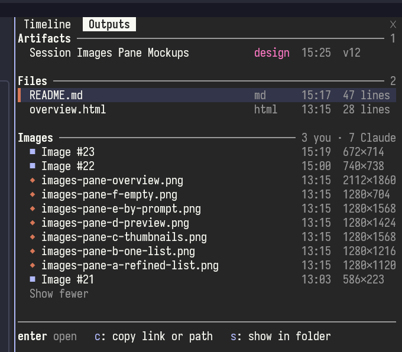

# session-outputs

An Outputs pane that lists what the current session produced, in three groups.



- **Artifacts**: the claude.ai Artifacts Claude published (designs, docs, slides, dashboards, pages), each with its kind, when it was last published and its version.
- **Files**: documents a tool call wrote or changed: `.pdf`, `.docx`, `.pptx`, `.xlsx`, `.csv`, `.md`, `.html` and their kin, each with its line count, or its size for a binary file. An Artifact's own source files are left out: its row stands for them.
- **Images**: the images you pasted into the prompt (■), including ones from before a compaction, and the image files a tool call wrote or changed (◆), such as a chart a script saved or a screenshot taken with a command. Images Claude only read are left out.

Each group is newest first, shows five rows until you ask for more, and is hidden while it is empty. Click a row, or move to it with Tab and press Enter, to open it: a file in its default app, an Artifact in the browser. The row you last opened or moved to is highlighted, and the keys at the foot of the pane act on it:

- `c` copies its link, or its path.
- `s` shows it in its folder: the file selected in Explorer on WSL, or the folder an Artifact's files are kept in.

The pane opens by itself the first time a session has something to list. `/session-outputs` opens it again after you close it.

## Opening things

On WSL, a row opens through `explorer.exe`, the same as a double click: a file in its Windows default app, a link in the default browser. Elsewhere it uses `xdg-open`.

## What it misses

- Screenshots a tool returns without saving them to a file.
- A path with spaces that a call names without quotes around it, such as one a script prints.
- A file a script writes when the call that runs the script never names it, such as a path the script builds from parts.
- Files Claude created earlier in a session that a compaction has removed from the conversation.
- The publish time of an Artifact the pane only learns of when it loads midway through a session: those show the time it loaded.
- Docs made through the Claude Docs connector are matched by the link in its answer, which has not been checked against a real one.

## Install

```
/plugin install session-outputs --marketplace xRyul/claude-plugins-and-mods-by-xryul
```

## Licence

MIT
